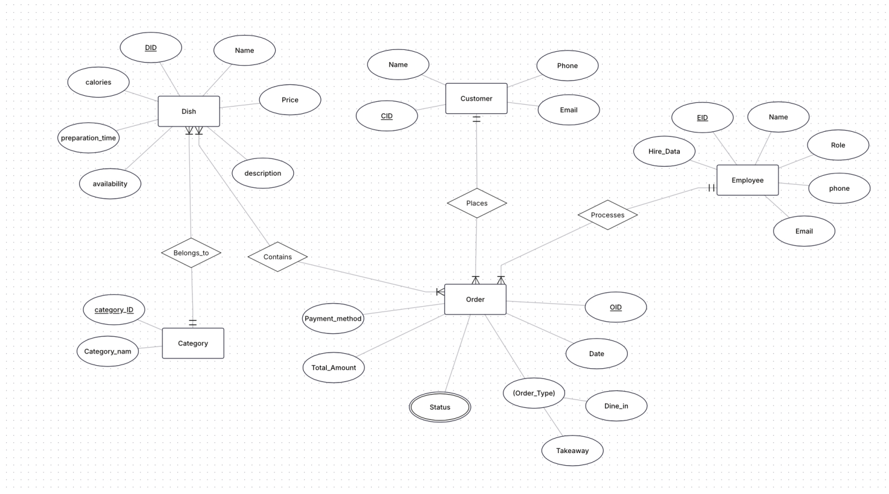
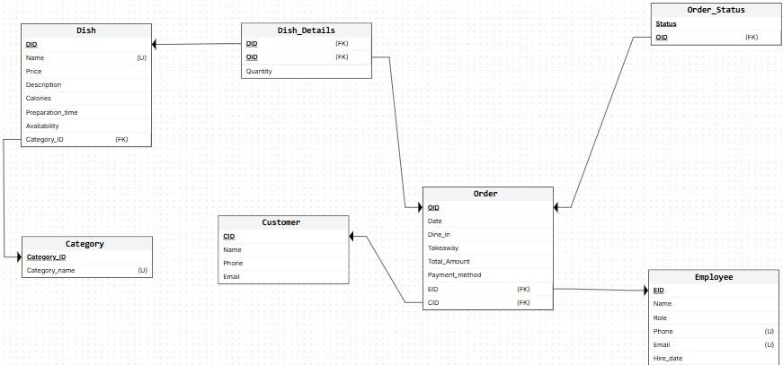

# Kababa Restaurant Database

A relational database for **"Kababa"**, a Saudi grilled-cuisine restaurant. It covers the full design path: a real-world scenario, an ER diagram, a relational schema, and a working **MySQL** implementation with constraints, sample data and analytical queries.

## ER diagram

<p align="center"></p>

## Relational schema

<p align="center"></p>

| Table | Purpose |
|---|---|
| `Category` | Menu categories: Main Dishes, Side Dishes, Drinks, Sauces |
| `Dish` | Menu items with price, calories, preparation time and availability |
| `Customer` | Customer contact information |
| `Employee` | Staff and their roles: Waiter, Cashier, Chef |
| `Orders` | Orders with type (dine-in/takeaway), payment method, total, employee and customer |
| `Orders_Status` | Order lifecycle: pending, preparing, completed, cancelled |
| `Dish_Details` | The many-to-many link between orders and dishes, with quantity |

**Design features:**

- `PRIMARY KEY`, `FOREIGN KEY`, `NOT NULL` and `UNIQUE` constraints
- `ENUM` domains for categories, roles, order types and statuses
- Composite primary keys on the link tables
- Referential actions: `ON DELETE SET NULL` and `ON UPDATE CASCADE`

## Queries

[`sql/02_queries.sql`](sql/02_queries.sql) covers:

| Category | Examples |
|---|---|
| Basic `SELECT` / filtering | Dishes above 20 SAR, customers by phone prefix, chefs on staff |
| Aggregates | Total revenue, average price per category, highest order amount |
| Joins | Customers with their orders, dishes with their category, order status |
| Subqueries | Dishes above their category's average calories, dishes never ordered |
| Views | `Category_Stats`, `Order_Report`, `Dish_Prices_View` |

**Example:** dishes with more calories than the average in their own category (a correlated subquery):

```sql
SELECT DName, Calories
FROM Dish d
WHERE Calories > (
    SELECT AVG(Calories)
    FROM Dish
    WHERE Category_ID = d.Category_ID
);
```

**Example:** a reporting view of average price and calories per category:

```sql
CREATE VIEW Category_Stats AS
SELECT Category.Category_name, AVG(Dish.Price) AS Avg_Price, AVG(Dish.Calories) AS Avg_Calories
FROM Category
JOIN Dish ON Category.Category_ID = Dish.Category_ID
GROUP BY Category.Category_name;
```

## Tech stack

MySQL · SQL (DDL, DML, joins, subqueries, views) · ER modeling
